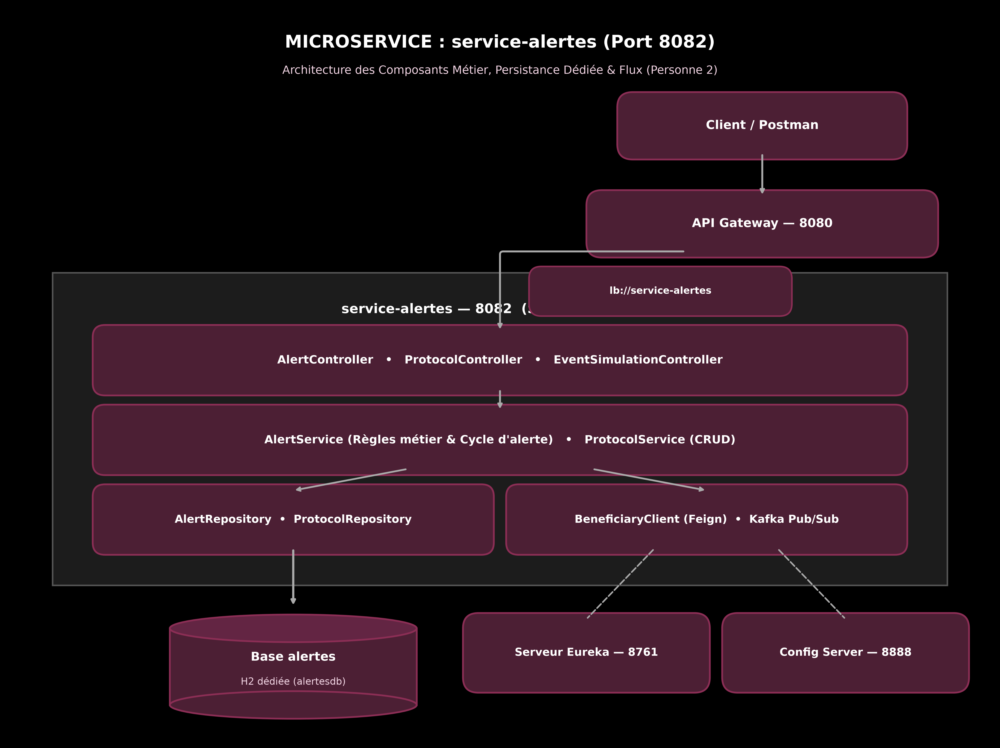
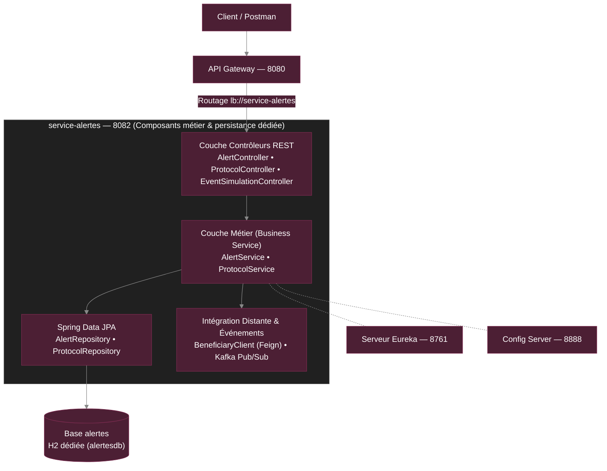
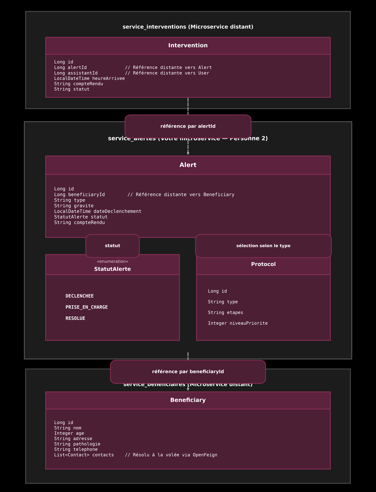
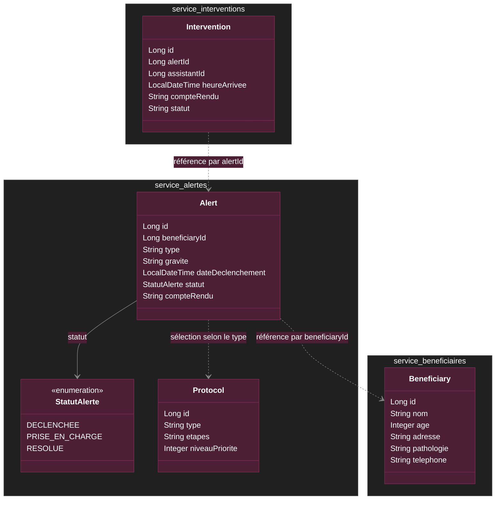

# Microservice : service-alertes (Port 8082)
> **Projet :** Assistance à domicile pour personnes âgées  
> **Rôle :** Personne 2 — Gestionnaire des alertes et de leur cycle de vie (Service Principal ⭐)  
> **Livrables :** Phases V0 à V6 (Architecture, CRUD, Eureka, Gateway, Config Server, OpenFeign, Kafka, Résilience)

---

## 1. Documentation d'Architecture & Conception — Phase V0 (Votre Partie : `service-alertes`)

### A. Schéma d'Architecture de `service-alertes`

Ce schéma présente **l'architecture détaillée et les flux d'échanges de votre microservice (`service-alertes` — 8082)**, avec le style visuel officiel du projet (fond noir, nœuds violet/prune `#4c1f34`, conteneur gris `#202020`, base de données dédiée H2) :



<details>
<summary>▶ Voir le code source Mermaid de l'architecture</summary>



</details>

---

### B. Diagramme de Classes & Gestion des Références Distantes (`service-alertes`)

Ce diagramme détaille les entités et composants de **votre microservice** et la structure exacte des références distantes inter-services (avec les mêmes couleurs et relations que le schéma officiel) :



<details>
<summary>▶ Voir le code source Mermaid du diagramme de classes</summary>



</details>

#### Explicitation de la Gestion des Références Distantes (Spécifique à `service-alertes`) :
- **Principe d'isolation des bases (*Database per Service*) :** Conformément à l'architecture microservices, aucune table ni clé étrangère SQL (`FOREIGN KEY`) ne lie `Alert` aux autres entités.
- **Référence `beneficiaryId` (Sortante) :** `Alert` stocke uniquement l'identifiant distant `Long beneficiaryId`.
  1. *Validation au déclenchement :* `AlertService` utilise `BeneficiaryClient` (OpenFeign) pour vérifier l'existence du bénéficiaire dans `service-beneficiaires` (8081).
  2. *Enrichissement à la volée :* L'endpoint `GET /api/alerts/{id}/enriched` agrège les données du bénéficiaire et ses contacts d'urgence sans jointure SQL.
- **Référence `alertId` (Entrante depuis `service-interventions`) :** `service-interventions` stocke `Long alertId` et notifie `service-alertes` via les événements Kafka (`intervention-assigned` ➔ `PRISE_EN_CHARGE`, `emergency-resolved` ➔ `RESOLUE`).
- **Autonomie de test ("Pour avancer seule") :** Si `service-beneficiaires` n'est pas encore démarré par votre coéquipier, le fallback Feign intégré (`BeneficiaryClientFallback`) fournit automatiquement des données simulées réalistes.

---

## 2. Description du Microservice Principal `service-alertes` (Port 8082)

Ce service gère l'unité centrale de traitement du système : **l'Alerte** et son cycle de vie :
$$\text{DECLENCHEE} \longrightarrow \text{PRISE\_EN\_CHARGE} \longrightarrow \text{RESOLUE}$$

### Responsabilités :
1. **CRUD et sélection des protocoles d'urgence :** (`CHUTE`, `MALAISE`, `URGENCE_CARDIAQUE`, `INTRUSION`, etc.).
2. **Déclenchement d'alertes :** validation de compatibilité du protocole et vérification préalable du bénéficiaire.
3. **Consultation enrichie :** agrégation à la volée du protocole, du dossier bénéficiaire et des contacts d'urgence.
4. **Communication asynchrone Kafka :** publication de `alert-triggered` et consommation des événements d'intervention.
5. **Autonomie de test (*"Pour avancer seule"*) :** fallback Feign automatique et simulateur d'injection d'événements Kafka.

---

## 3. Guide de Démarrage & Prérequis

### Prérequis
- Java 21 ou supérieur
- Apache Maven 3.9+

### Démarrage des Services de Base
Pour tester la chaîne complète :
```powershell
# 1. Démarrer le Registre Eureka (8761)
cd eureka-server && java -jar target/eureka-server-1.0.0-SNAPSHOT.jar

# 2. Démarrer le Serveur de Configuration (8888)
cd config-server && java -jar target/config-server-1.0.0-SNAPSHOT.jar

# 3. Démarrer le microservice service-alertes (8082)
cd service-alertes && java -jar target/service-alertes-1.0.0-SNAPSHOT.jar

# 4. Démarrer l'API Gateway (8080)
cd api-gateway && java -jar target/api-gateway-1.0.0-SNAPSHOT.jar
```

---

## 4. Endpoints de l'API REST

### A. Protocoles d'Urgence (`/api/protocols`)
- `POST /api/protocols` : Créer un protocole (201 Created)
- `GET /api/protocols` : Lister tous les protocoles (200 OK)
- `GET /api/protocols/{id}` : Détails d'un protocole par ID (200 OK)
- `GET /api/protocols/type/{type}` : Récupérer un protocole par son type (ex: CHUTE) (200 OK)
- `PUT /api/protocols/{id}` : Mettre à jour un protocole (200 OK)
- `DELETE /api/protocols/{id}` : Supprimer un protocole (204 No Content)

### B. Gestion des Alertes (`/api/alerts`)
- `POST /api/alerts` : Déclencher une alerte pour un bénéficiaire (201 Created)
- `GET /api/alerts` : Lister toutes les alertes (200 OK)
- `GET /api/alerts?statut=DECLENCHEE` : Filtrer les alertes par statut (`DECLENCHEE`, `PRISE_EN_CHARGE`, `RESOLUE`)
- `GET /api/alerts/{id}` : Détails d'une alerte spécifique (200 OK)
- `GET /api/alerts/{id}/enriched` : **Consultation enrichie (Alerte + Protocole + Dossier Bénéficiaire + Contacts)**
- `PATCH /api/alerts/{id}/status` : Évolution manuelle de statut (200 OK)
- `DELETE /api/alerts/{id}` : Supprimer une alerte (204 No Content)

### C. Simulation & Injection d'Événements Kafka (`/api/alerts/simulation`)
*Conçu pour Personne 2 pour avancer seule sans attendre les autres services :*
- `POST /api/alerts/simulation/inject-intervention-assigned` : Simule l'événement Kafka `intervention-assigned` ➔ passe l'alerte à `PRISE_EN_CHARGE`.
- `POST /api/alerts/simulation/inject-emergency-resolved` : Simule l'événement Kafka `emergency-resolved` ➔ passe l'alerte à `RESOLUE` avec compte-rendu.

---

## 5. Collection Postman Complète

Le fichier [`postman/service-alertes-v1.postman_collection.json`](file:///C:/Users/hp/.gemini/antigravity/scratch/service-alertes/postman/service-alertes-v1.postman_collection.json) contient la suite complète des scénarios d'évaluation :
- Dossiers 1 à 5 : CRUD Protocoles, Déclenchement, Filtres, Cycle de vie, Cas d'erreurs (V1).
- Dossier 6 : Tests Service Discovery (Eureka), Config Server et Gateway 8080 (V2 & V3).
- Dossier 7 : Tests OpenFeign et Consultation Enrichie (V4).
- Dossier 8 : Tests Asynchrones & Injection d'Événements (V5).

---

## 6. Résilience & Tolérance aux Pannes — Phase V6

Le microservice applique le pattern **Circuit Breaker** et **Retry** via **Resilience4j** sur le client OpenFeign `BeneficiaryClient` :
- **Instance Resilience4j :** `beneficiaires-service`
- **Retry :** 3 tentatives espacées de 500ms
- **Circuit Breaker :** Fenêtre glissante de 6 appels, seuil d'échec à 50%
- **Méthodes de repli (Fallback) :** `fallbackBeneficiary` et `fallbackContacts` basculent instantanément sur les données simulées sans faire échouer le service.
- **Gestion centralisée des erreurs :** `GlobalExceptionHandler` (`@RestControllerAdvice`) gère les codes `400 Bad Request`, `404 Not Found` et `500 Internal Error`.
