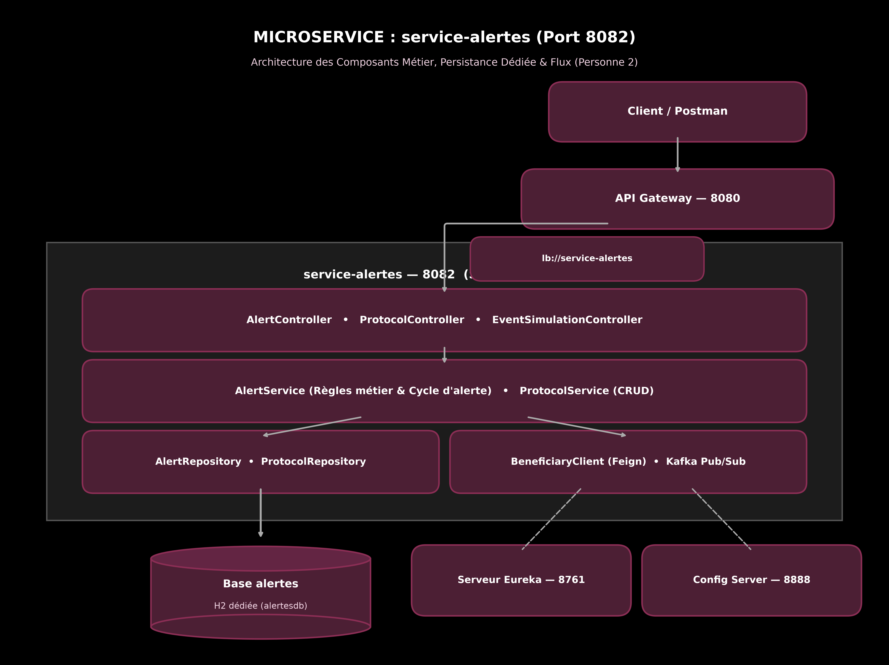
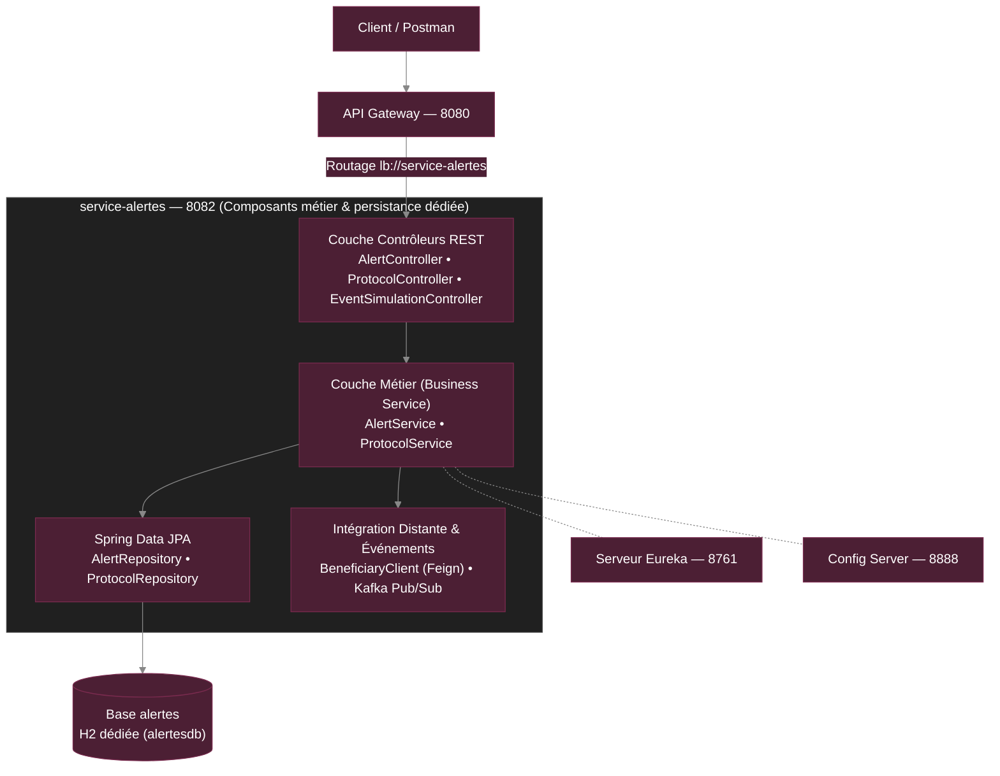
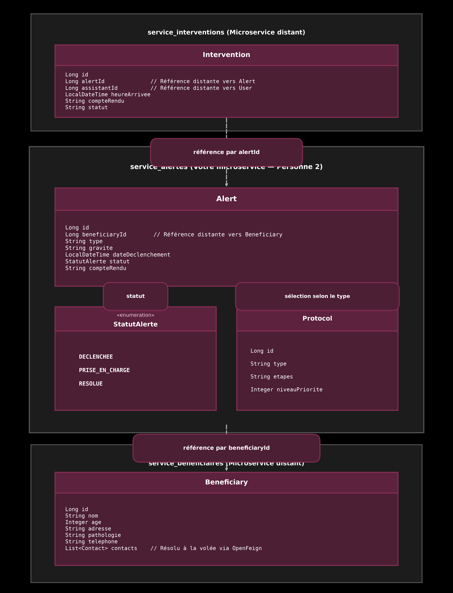
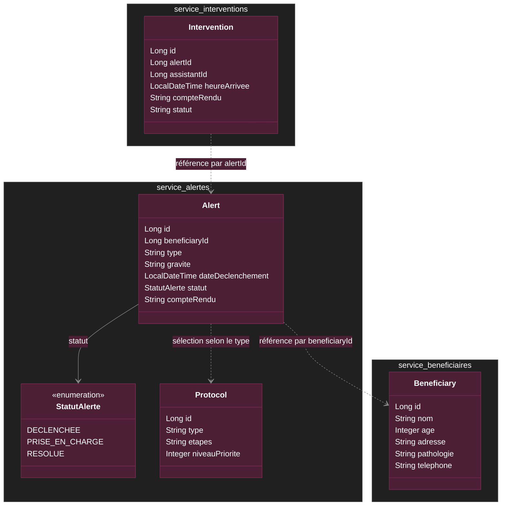

# Phase V0 : Conception & Architecture Détaillée — `service-alertes` (Personne 2)

> **Microservice :** `service-alertes` (Port 8082 — Service Principal ⭐)  
> **Auteur :** Personne 2  
> **Livrable officiel :** Phase V0 de la Grille d'Évaluation (Vue d'ensemble et focus microservice assigné)

---

## 1. Schéma d'Architecture de `service-alertes`

Ce schéma présente **l'architecture détaillée et les flux d'échanges de votre microservice (`service-alertes` — 8082)**, avec le style visuel officiel du projet (fond noir, nœuds violet/prune `#4c1f34`, conteneur gris `#202020`, base de données dédiée H2) :



<details>
<summary>▶ Voir le code source Mermaid de l'architecture</summary>



</details>

---

## 2. Diagramme de Classes & Gestion des Références Distantes (`service-alertes`)

Ce diagramme détaille les entités et composants de **votre microservice** et la structure exacte des références distantes inter-services (avec les mêmes couleurs et relations que le schéma officiel) :



<details>
<summary>▶ Voir le code source Mermaid du diagramme de classes</summary>



</details>

---
    %% Package Entity
    class Alert {
        -Long id
        -Long beneficiaryId
        -String type
        -String gravite
        -LocalDateTime dateDeclenchement
        -AlertStatus statut
        -String compteRendu
        +getId() Long
        +getBeneficiaryId() Long
        +getType() String
        +getStatut() AlertStatus
        +setStatut(AlertStatus)
        +setCompteRendu(String)
    }

    class AlertStatus {
        <<enumeration>>
        DECLENCHEE
        PRISE_EN_CHARGE
        RESOLUE
    }

    class Protocol {
        -Long id
        -String type
        -String etapes
        -Integer niveauPriorite
        +getId() Long
        +getType() String
        +getEtapes() String
        +getNiveauPriorite() Integer
    }

    %% Package DTO
    class AlertCreateDTO {
        +Long beneficiaryId
        +String type
        +String gravite
    }

    class AlertResponseDTO {
        +Long id
        +Long beneficiaryId
        +String type
        +String gravite
        +LocalDateTime dateDeclenchement
        +AlertStatus statut
        +String compteRendu
    }

    class EnrichedAlertDTO {
        +Long id
        +Long beneficiaryId
        +String type
        +AlertStatus statut
        +ProtocolResponseDTO protocol
        +BeneficiaryDTO beneficiary
        +List~ContactDTO~ emergencyContacts
    }

    class ProtocolRequestDTO {
        +String type
        +String etapes
        +Integer niveauPriorite
    }

    %% Package Repositories
    class AlertRepository {
        <<interface>>
        +findByStatut(AlertStatus) List~Alert~
        +findByBeneficiaryId(Long) List~Alert~
    }

    class ProtocolRepository {
        <<interface>>
        +findByTypeIgnoreCase(String) Optional~Protocol~
        +existsByTypeIgnoreCase(String) boolean
    }

    %% Package Services
    class AlertService {
        -AlertRepository alertRepository
        -ProtocolRepository protocolRepository
        -BeneficiaryClient beneficiaryClient
        -AlertEventPublisher alertEventPublisher
        +triggerAlert(AlertCreateDTO) AlertResponseDTO
        +getAlerts(AlertStatus) List~AlertResponseDTO~
        +getEnrichedAlertById(Long) EnrichedAlertDTO
        +updateAlertStatus(Long, AlertStatusUpdateDTO) AlertResponseDTO
    }

    class ProtocolService {
        -ProtocolRepository protocolRepository
        +createProtocol(ProtocolRequestDTO) ProtocolResponseDTO
        +getProtocolByType(String) ProtocolResponseDTO
        +getAllProtocols() List~ProtocolResponseDTO~
    }

    %% Package Controllers
    class AlertController {
        -AlertService alertService
        +triggerAlert(AlertCreateDTO) ResponseEntity
        +getAlerts(AlertStatus) ResponseEntity
        +getEnrichedAlertById(Long) ResponseEntity
        +updateAlertStatus(Long, AlertStatusUpdateDTO) ResponseEntity
    }

    class ProtocolController {
        -ProtocolService protocolService
        +createProtocol(ProtocolRequestDTO) ResponseEntity
        +getProtocolByType(String) ResponseEntity
    }

    %% Package Feign & Kafka
    class BeneficiaryClient {
        <<interface>>
        +getBeneficiaryById(Long) BeneficiaryDTO
        +getContactsByBeneficiaryId(Long) List~ContactDTO~
    }

    class AlertEventPublisher {
        +publishAlertTriggered(Alert)
    }

    class AlertEventConsumer {
        +onInterventionAssigned(InterventionAssignedEvent)
        +onEmergencyResolved(EmergencyResolvedEvent)
    }

    %% Relations
    Alert --> AlertStatus : statut
    AlertService --> AlertRepository
    AlertService --> ProtocolRepository
    AlertService --> BeneficiaryClient
    AlertService --> AlertEventPublisher
    AlertEventConsumer --> AlertService
    AlertController --> AlertService
    ProtocolController --> ProtocolService
    ProtocolService --> ProtocolRepository
```

</details>

---

## 3. Gestion des Références Distantes Spécifique à `service-alertes`

En tant que responsable de `service-alertes`, vous n'avez pas de relation SQL `FOREIGN KEY` vers les autres bases. Voici comment votre code gère les relations avec les autres services :

| Référence Distante | Champ stocké dans `Alert` | Service Propriétaire | Mécanisme de Résolution |
|---|---|---|---|
| **Bénéficiaire** | `Long beneficiaryId` | `service-beneficiaires` | **OpenFeign (Synchrone) :** `BeneficiaryClient` vérifie l'existence du bénéficiaire lors de la création et récupère ses contacts pour composer `EnrichedAlertDTO`. |
| **Protocole d'urgence** | `String type` | `service-alertes` *(local)* | **Interne (JPA) :** Sélectionne les étapes d'urgence associées au type d'alerte (`CHUTE`, `MALAISE`, etc.). |
| **Intervention associée** | Notifié par événements | `service-interventions` | **Kafka (Asynchrone) :** `AlertEventConsumer` écoute `intervention-assigned` (`PRISE_EN_CHARGE`) et `emergency-resolved` (`RESOLUE` + compte-rendu). |

---

## 4. Synthèse des Couches de Votre Projet

| Couche | Rôle dans `service-alertes` | Classes Principales |
|---|---|---|
| **`entity`** | Modèle de données persistant en base H2 | `Alert`, `Protocol`, `AlertStatus` |
| **`dto`** | Objets d'échange entrants et sortants validés | `AlertCreateDTO`, `EnrichedAlertDTO`, `ProtocolRequestDTO` |
| **`repository`** | Accès aux données JPA | `AlertRepository`, `ProtocolRepository` |
| **`service`** | Règles métier, validations et transitions d'état | `AlertService`, `ProtocolService` |
| **`controller`** | API REST exposées aux clients et à la Gateway | `AlertController`, `ProtocolController`, `EventSimulationController` |
| **`client`** | Appels synchrones vers `service-beneficiaires` | `BeneficiaryClient`, `BeneficiaryClientFallback` |
| **`event`** | Envoi et réception asynchrones Kafka | `AlertEventPublisher`, `AlertEventConsumer` |
