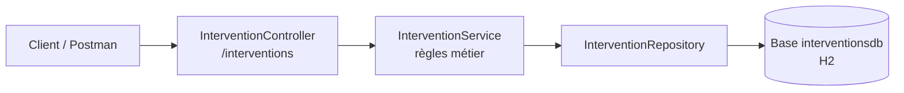

# service-interventions

Microservice du projet **Tele-Care** (assistance à domicile pour personnes âgées).
Il gère la **prise en charge terrain** d'une urgence : affectation d'un assistant d'astreinte, heure d'arrivée, compte-rendu et clôture.

| | |
|---|---|
| **Réalisé par** | Soukaina — Personne 3 |
| **Port** | 8083 |
| **Base de données** | H2 en mémoire (`interventionsdb`), propre au service |
| **Jalon livré** | **v1.0** — Mise en place des services métier |

---

## 1. Prérequis

| Outil | Version |
|---|---|
| Java (JDK) | 17 |
| Maven | Non requis, le wrapper `mvnw` est fourni |
| Spring Boot | 3.5.6 |
| Spring Cloud (BOM) | 2025.0.0 (aucune dépendance Cloud utilisée pour l'instant) |
| Postman | Pour rejouer la collection de tests |

## 2. Architecture du service



Architecture en couches **Controller → Service → Repository → Entité**, avec des **DTO** validés (`@Valid`) et un mapping par **MapStruct**.
Le service a sa **propre base de données** (*Database per Service*) : il ne partage aucune table avec les autres services.

```
src/main/java/com/telecare/serviceinterventions
├── controller   InterventionController
├── service      InterventionService
├── repository   InterventionRepository
├── entite       Intervention, StatutIntervention
├── dto          InterventionCreationDto, ArriveeDto, CompteRenduDto, InterventionDto
├── mapper       InterventionMapper
└── exception    RessourceIntrouvableException, TransitionInterditeException, InterventionExistanteException
```

## 3. Modèle de données

Entité **`Intervention`**, conforme au diagramme de classes de l'équipe :

| Attribut | Type | Description |
|---|---|---|
| `id` | `Long` | Identifiant généré |
| `alertId` | `Long` | **Référence distante** vers l'alerte (service-alertes). Aucune clé étrangère, car la base est séparée. Unique : une seule intervention par alerte |
| `assistantNom` | `String` | Assistant d'astreinte affecté (obligatoire) |
| `heureArrivee` | `LocalDateTime` | Heure d'arrivée sur place |
| `compteRendu` | `String` | Compte-rendu de l'intervention (2000 caractères max) |
| `statut` | `StatutIntervention` | Stocké en texte en base |

### Cycle de vie du statut

Le cahier des charges ne fixe pas les valeurs de `statut`. Choix de conception de l'équipe :

```
AFFECTEE  ──(arrivée enregistrée)──▶  SUR_PLACE  ──(compte-rendu + clôture)──▶  CLOTUREE
```

| Action | Condition | Sinon |
|---|---|---|
| Créer | Aucune intervention pour cet `alertId` | `409` |
| Enregistrer l'arrivée | Statut `AFFECTEE` | `409` |
| Rédiger le compte-rendu | Statut `SUR_PLACE` | `409` |
| Clôturer | Statut `SUR_PLACE` et compte-rendu rédigé | `409` |
| Supprimer | Statut différent de `CLOTUREE` | `409` |

## 4. API REST

| Méthode | URL | Rôle | Succès |
|---|---|---|---|
| `GET` | `/interventions` | Lister (filtre optionnel `?statut=SUR_PLACE`) | `200` |
| `GET` | `/interventions/{id}` | Consulter une intervention | `200` |
| `POST` | `/interventions/new` | Créer une intervention | `201` + `Location` |
| `PUT` | `/interventions/{id}/arrivee` | Enregistrer l'heure d'arrivée (corps facultatif, heure actuelle par défaut) | `200` |
| `PUT` | `/interventions/{id}/compte-rendu` | Rédiger le compte-rendu | `200` |
| `PUT` | `/interventions/{id}/cloture` | Clôturer l'intervention | `200` |
| `DELETE` | `/interventions/{id}` | Supprimer une intervention | `204` |

**Codes d'erreur** : `400` données invalides (validation) · `404` ressource inexistante · `409` transition de statut interdite ou doublon d'`alertId`.

Exemple de création :

```json
POST /interventions/new
{
  "alertId": 42,
  "assistantNom": "Karim Benali"
}
```

## 5. Lancer le service

Depuis le dossier `service-interventions` :

```powershell
.\mvnw.cmd spring-boot:run
```

Vérification : <http://localhost:8083/actuator/health> doit renvoyer `{"status":"UP"}`.

## 6. Tests

La collection Postman est dans [`postman/service-interventions.postman_collection.json`](postman/service-interventions.postman_collection.json).

1. Démarrer le service (port 8083).
2. Dans Postman : **Import** puis choisir le fichier de la collection.
3. Clic droit sur la collection → **Run collection**.

**27 requêtes, 36 tests automatiques, tous réussis.**

| Dossier | Couverture |
|---|---|
| 1 — Cas valides | Cycle complet : création, consultation, arrivée, compte-rendu, clôture, filtre |
| 2 — Erreurs de validation | Corps invalide, JSON cassé, statut inconnu (`400`) |
| 3 — Ressources inexistantes | Identifiant inexistant sur chaque endpoint (`404`) |
| 4 — Règles métier | Doublon, clôture avant arrivée, double arrivée, suppression interdite (`409`), suppression valide (`204`) |

## 7. Avancement par jalon

| Jalon | Contenu pour service-interventions | État |
|---|---|---|
| **v1.0** | Couches Controller / Service / Repository, DTO validés, base propre, API REST, gestion des erreurs, tests Postman | **Terminé** |
| v2.0 | Enregistrement dans Eureka (client) | À venir |
| v3.0 | Configuration depuis le Config Server | À venir |
| v4.0 | Client OpenFeign vers service-alertes (consultation du `Protocol`) | À venir |
| v5.0 | Kafka : consommer `alert-triggered`, publier `intervention-assigned` et `emergency-resolved` | À venir |
| v6.0 | Circuit Breaker et Retry sur Feign, `@ControllerAdvice`, idempotence | À venir |

## 8. Périmètre

Ce service correspond uniquement à la **Personne 3** du cahier des charges. Les services `service-beneficiaires` (Personne 1), `service-alertes` (Personne 2) et l'infrastructure Eureka / Gateway / Kafka (Personne 4) sont développés par les autres membres de l'équipe.
