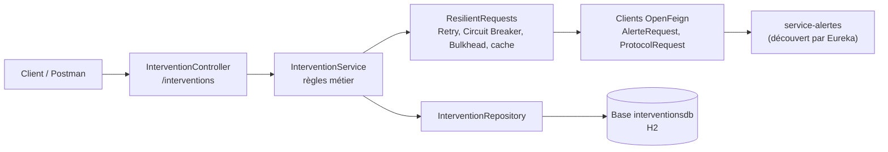

> Version corrigee : consulter [LISEZMOI_CORRECTIONS](../LISEZMOI_CORRECTIONS.md) et la collection commune `../postman/TeleCare-Validation.postman_collection.json`. Les collections et indications de jalons ci-dessous sont historiques.

# service-interventions

Microservice du projet **Tele-Care** (assistance à domicile pour personnes âgées).
Il gère la **prise en charge terrain** d'une urgence : affectation d'un assistant d'astreinte, heure d'arrivée, compte-rendu et clôture.

| | |
|---|---|
| **Port** | 8083 |
| **Base de données** | H2 en mémoire (`interventionsdb`), propre au service |
| **Jalon livré** | **v6.0** — Résilience : délais d'attente, Retry, Circuit Breaker, Bulkhead, cache de repli et RateLimiter sur les appels vers service-alertes (après v1.0 : services métier, v2.0 : client Eureka, v3.0 : Config Server, v4.0 : OpenFeign, v5.0 : Kafka) |

---

## 1. Prérequis

| Outil | Version |
|---|---|
| Java (JDK) | 17 |
| Maven | Non requis, le wrapper `mvnw` est fourni |
| Spring Boot | 3.5.6 |
| Spring Cloud (BOM) | 2025.0.0 (clients Eureka, Config et OpenFeign, Resilience4j) |
| Postman | Pour rejouer la collection de tests |
| Serveur Eureka | Port 8761. Sans lui, le service démarre quand même (avertissements de connexion dans la console) |
| Config Server | Port 8888. **Sans lui, le service refuse de démarrer** (comportement voulu, voir 5.2) |
| service-alertes | Port 8082, appelé par OpenFeign (voir 5.3). Sans lui, la création répond `503` et la consultation enrichie passe en mode dégradé (voir 5.5) |
| Kafka | Conteneur Docker, port 9092, avec les topics `alert-triggered`, `intervention-assigned` et `emergency-resolved` (voir 5.4). Sans lui, la publication des événements échoue (erreur journalisée, l'intervention reste enregistrée) |

## 2. Architecture du service



Architecture en couches **Controller → Service → Repository → Entité**, avec des **DTO** validés (`@Valid`) et un mapping par **MapStruct**.
Le service a sa **propre base de données** (*Database per Service*) : il ne partage aucune table avec les autres services.

```
src/main/java/com/telecare/serviceinterventions
├── controller   InterventionController
├── service      InterventionService
├── repository   InterventionRepository
├── entite       Intervention, StatutIntervention
├── dto          InterventionCreationDto, InterventionModificationDto, ArriveeDto, CompteRenduDto,
│                InterventionDto, InterventionDetailDto
├── feignClient  AlerteRequest, ProtocolRequest, AlerteDto, ProtocolDto, ResilientRequests
├── config       CacheConfig, KafkaConfig
├── mapper       InterventionMapper
└── exception    RessourceIntrouvableException, TransitionInterditeException, InterventionExistanteException,
                 ServiceExterneIndisponibleException, GlobalExceptionHandler
```

## 3. Modèle de données

Entité **`Intervention`**, conforme au diagramme de classes du projet :

| Attribut | Type | Description |
|---|---|---|
| `id` | `Long` | Identifiant généré |
| `alertId` | `Long` | **Référence distante** vers l'alerte (service-alertes). Aucune clé étrangère, car la base est séparée. Unique : une seule intervention par alerte |
| `assistantNom` | `String` | Assistant d'astreinte affecté (obligatoire) |
| `heureArrivee` | `LocalDateTime` | Heure d'arrivée sur place |
| `compteRendu` | `String` | Compte-rendu de l'intervention (2000 caractères max) |
| `statut` | `StatutIntervention` | Stocké en texte en base |

### Cycle de vie du statut

Le cahier des charges ne fixe pas les valeurs de `statut`. Choix de conception :

```
AFFECTEE  ──(arrivée enregistrée)──▶  SUR_PLACE  ──(compte-rendu + clôture)──▶  CLOTUREE
```

| Action | Condition | Sinon |
|---|---|---|
| Créer | Aucune intervention pour cet `alertId` | `409` |
| Enregistrer l'arrivée | Statut `AFFECTEE` | `409` |
| Rédiger le compte-rendu | Statut `SUR_PLACE` | `409` |
| Clôturer | Statut `SUR_PLACE` et compte-rendu rédigé | `409` |
| Modifier l'assistant | Statut différent de `CLOTUREE` | `409` |
| Supprimer | Statut différent de `CLOTUREE` | `409` |

## 4. API REST

| Méthode | URL | Rôle | Succès |
|---|---|---|---|
| `GET` | `/interventions` | Lister (filtre optionnel `?statut=SUR_PLACE`) | `200` |
| `GET` | `/interventions/{id}` | Consulter une intervention | `200` |
| `GET` | `/interventions/{id}/detail` | Consultation enrichie : intervention, alerte et protocole (OpenFeign) | `200` |
| `POST` | `/interventions/new` | Créer une intervention, après vérification de l'alerte et de son protocole | `201` + `Location` |
| `PUT` | `/interventions/{id}` | Modifier l'assistant affecté (interdit si `CLOTUREE`) | `200` |
| `PUT` | `/interventions/{id}/arrivee` | Enregistrer l'heure d'arrivée (corps facultatif, heure actuelle par défaut) | `200` |
| `PUT` | `/interventions/{id}/compte-rendu` | Rédiger le compte-rendu | `200` |
| `PUT` | `/interventions/{id}/cloture` | Clôturer l'intervention | `200` |
| `DELETE` | `/interventions/{id}` | Supprimer une intervention | `204` |

**Codes d'erreur** : `400` données invalides (validation) · `404` ressource inexistante (locale ou distante) · `409` transition de statut interdite, doublon d'`alertId` ou refus métier · `502` erreur HTTP du service distant · `503` service distant indisponible (création refusée, voir 5.5).

Exemple de création :

```json
POST /interventions/new
{
  "alertId": 42,
  "assistantNom": "Karim Benali"
}
```

## 5. Lancer le service

**Ordre de démarrage** : Eureka (8761), Config Server (8888), service-alertes (8082), puis ce service (8083).

Depuis le dossier `service-interventions` :

```powershell
.\mvnw.cmd spring-boot:run
```

Vérification : <http://localhost:8083/actuator/health> doit renvoyer `{"status":"UP"}`.

### 5.1 Enregistrement dans Eureka (jalon v2.0)

Le service est un **client Eureka** : au démarrage, il s'enregistre auprès du serveur Eureka (port 8761) pour pouvoir être découvert par la Gateway.

| Élément | Valeur |
|---|---|
| Nom dans Eureka | `SERVICE-INTERVENTIONS` (valeur de `spring.application.name`) |
| Port | 8083 |
| Identifiant d'instance | `localhost:service-interventions:8083` |
| Statut attendu | `UP` |

Configuration (située dans `config-repo/service-interventions.properties` depuis le jalon v3.0) :

```properties
eureka.client.service-url.defaultZone=http://localhost:8761/eureka/
eureka.instance.hostname=localhost
eureka.instance.instance-id=${eureka.instance.hostname}:${spring.application.name}:${server.port}
```

La dépendance `spring-cloud-starter-netflix-eureka-client` est ajoutée au `pom.xml`, et la classe principale porte `@EnableDiscoveryClient`.

**Vérification** : démarrer le serveur Eureka, puis le service, et ouvrir <http://localhost:8761>. L'application `SERVICE-INTERVENTIONS` doit apparaître avec le statut `UP`.


### 5.2 Configuration centralisée (jalon v3.0)

La configuration du service n'est plus dans le projet : elle est dans le dossier **`config-repo`**, à la racine du dépôt Git, et servie par le Config Server.

| Élément | Emplacement |
|---|---|
| Configuration du service (port, base H2, JPA, erreurs, Eureka) | `config-repo/service-interventions.properties` |
| Configuration locale | `service-interventions/src/main/resources/application.properties` : **deux lignes seulement** |

Contenu de la configuration locale :

```properties
spring.application.name=service-interventions
spring.config.import=configserver:http://localhost:8888
```

- `spring.application.name` identifie le fichier à charger côté serveur (`service-interventions.properties`).
- `spring.config.import` charge la configuration distante au démarrage.
- Sans `optional:`, le service **refuse de démarrer** si le Config Server est injoignable (comportement *fail-fast* voulu par le TP).

La dépendance `spring-cloud-starter-config` est ajoutée au `pom.xml`.

**Vérification** : ouvrir <http://localhost:8888/service-interventions/default>. La réponse doit contenir `server.port` à `8083`, `spring.datasource.url` à `jdbc:h2:mem:interventionsdb` et les propriétés Eureka. Le service démarre ensuite sans configuration locale, s'enregistre dans Eureka (`UP`), et les tests Postman restent réussis (voir section 6).

### 5.3 Communication synchrone avec OpenFeign (jalon v4.0)

Le service appelle `service-alertes` grâce à deux clients OpenFeign typés (`AlerteRequest`, `ProtocolRequest`). L'adresse n'est pas écrite en dur : le client utilise le nom `service-alertes` découvert par Eureka (`@EnableFeignClients`, avec `spring-cloud-starter-openfeign` et `spring-cloud-starter-loadbalancer`).

| Client | Appel | DTO de réponse |
|---|---|---|
| `AlerteRequest` | `GET /alertes/{id}` | `AlerteDto` (id, beneficiaryId, type, gravite, dateDeclenchement, statut) |
| `ProtocolRequest` | `GET /protocoles/type/{type}` | `ProtocolDto` (id, type, etapes, niveauPriorite) |

**Création contrôlée** (`POST /interventions/new`), dans cet ordre :

| # | Contrôle | En cas d'échec |
|---|---|---|
| 1 | Aucune intervention n'existe déjà pour cet `alertId` (**idempotence**, avant tout appel externe) | `409` |
| 2 | L'alerte existe | `404` « Ressource externe introuvable » |
| 3 | L'alerte est `DECLENCHEE` | `409` |
| 4 | Le protocole du type de l'alerte existe | `404` « Ressource externe introuvable » |
| 5 | Le type du protocole correspond au type de l'alerte | `409` |
| 6 | Création, statut `AFFECTEE` | `201` |

**Idempotence** : l'`alertId` sert de clé. Il est unique en base, et sa présence est vérifiée avant tout appel externe : une même alerte ne peut donner lieu qu'à une seule intervention.

**Gestion des erreurs de communication** (`GlobalExceptionHandler`) :

| Situation | Réponse |
|---|---|
| Ressource introuvable chez le service distant | `404` « Ressource externe introuvable » |
| Échec de communication (connexion impossible, délai dépassé) | `503` « Échec de communication avec un service » |
| Service ou instance indisponible | `503` « Service ou instance indisponible » |
| Autre erreur HTTP du service distant | `502` « Erreur HTTP du service distant : [statut] » |

**Consultation enrichie** : `GET /interventions/{id}/detail` assemble les données de l'intervention (base locale) et celles de l'alerte et de son protocole (OpenFeign) :

```json
{
  "id": 1, "alertId": 1000, "assistantNom": "Karim Benali",
  "heureArrivee": null, "compteRendu": null, "statut": "AFFECTEE",
  "alerteType": "CHUTE", "alerteGravite": "HAUTE", "alerteStatut": "DECLENCHEE",
  "protocoleEtapes": "1. Appeler les secours 2. Securiser la personne 3. Prevenir la famille",
  "protocoleNiveauPriorite": 1
}
```

### 5.4 Communication asynchrone avec Kafka (jalon v5.0)

Le service échange des événements JSON avec Kafka (port 9092). La configuration Kafka est dans `config-repo/service-interventions.properties`.

| Topic | Sens | Rôle |
|---|---|---|
| `alert-triggered` | Reçu | Création d'une intervention liée à `alertId`, avec un assistant d'astreinte pris dans une liste fictive |
| `intervention-assigned` | Publié | Après l'affectation de l'assistant |
| `emergency-resolved` | Publié | Après la clôture de l'intervention |

**Formats des messages** (JSON, clé du message Kafka = `alertId`) :

```json
alert-triggered (reçu) :
{ "alertId": 1000, "beneficiaryId": 1, "type": "CHUTE", "gravite": "HAUTE", "dateDeclenchement": "2026-11-09T10:15:30" }

intervention-assigned (publié) :
{ "eventId": "<uuid>", "interventionId": 1, "alertId": 1000, "beneficiaryId": 1, "assistantNom": "Karim Benali", "dateAffectation": "2026-11-09T10:15:32" }

emergency-resolved (publié) :
{ "eventId": "<uuid>", "interventionId": 1, "alertId": 1000, "beneficiaryId": 1, "compteRendu": "...", "dateCloture": "2026-11-09T11:02:10" }
```

Seul `alertId` est indispensable dans le message reçu ; les champs inconnus sont ignorés.

**Règles de traitement**

| Règle | Détail |
|---|---|
| Publication après commit | Le message est envoyé seulement une fois la transaction validée |
| Échec de publication | L'intervention reste enregistrée, l'erreur est journalisée |
| Idempotence | Un `alert-triggered` reçu deux fois ne crée qu'une intervention |
| Message invalide | Illisible ou sans `alertId` : ignoré et journalisé |
| Réessais | 3 tentatives au maximum, 2 secondes d'attente. Aucun réessai si l'alerte n'est pas `DECLENCHEE` ou si le protocole est incompatible |

**Éléments ajoutés** : champ `beneficiaryId` dans l'entité `Intervention` (copié depuis l'alerte à la création), packages `event` (3 événements), `messaging` (`InterventionEventPublisher`, `AlertTriggeredConsumer`) et `config` (`KafkaConfig`), et service `AssistantAstreinteService`.

**Commandes Docker** (une à la fois, PowerShell) :

```powershell
docker run -d --name kafka -p 9092:9092 apache/kafka:3.9.0
```

```powershell
docker exec kafka /opt/kafka/bin/kafka-topics.sh --create --topic alert-triggered --bootstrap-server localhost:9092
```

Répéter la commande de création pour `intervention-assigned` et `emergency-resolved`.

**Observer les messages publiés** :

```powershell
docker exec kafka /opt/kafka/bin/kafka-console-consumer.sh --bootstrap-server localhost:9092 --topic emergency-resolved --from-beginning
```

Même commande avec `--topic intervention-assigned` pour l'autre événement.

**Envoyer un `alert-triggered` de test** (format `clé:valeur`) :

```powershell
docker exec -it kafka /opt/kafka/bin/kafka-console-producer.sh --bootstrap-server localhost:9092 --topic alert-triggered --property parse.key=true --property key.separator=:
```

Puis saisir : `5001:{"alertId":5001,"beneficiaryId":1,"type":"CHUTE","gravite":"HAUTE"}`. Le renvoyer une deuxième fois : une seule intervention existe pour cet `alertId`.

### 5.5 Résilience des appels vers service-alertes (jalon v6.0)

Les deux appels OpenFeign vers `service-alertes` (`AlerteRequest` et `ProtocolRequest`) passent par la classe `ResilientRequests`, qui ajoute la couche de protection. Un RateLimiter protège aussi la consultation enrichie. Les propriétés sont dans `config-repo/service-interventions.properties`.

| Mécanisme | Emplacement | Réglage |
|---|---|---|
| Délais d'attente | OpenFeign | Connexion 1 s, réponse 2 s |
| Retry | `ResilientRequests` | 3 tentatives, 500 ms d'attente, sur les erreurs de communication et le `503` distant, pour l'alerte (`alertes-service`) et pour le protocole (`protocole-service`) |
| Circuit Breaker | `ResilientRequests` | Fenêtre de 6 appels, minimum 4 appels, seuil d'échec 50 %, passage automatique en `HALF_OPEN`, erreurs `4xx` ignorées ; 10 s à l'état ouvert pour l'alerte, 5 s pour le protocole |
| Bulkhead | `ResilientRequests` | 10 appels simultanés au maximum par service distant, sans attente |
| RateLimiter | `InterventionService.getInterventionDetail` | 5 consultations enrichies par seconde, sans attente |
| Cache Caffeine | `CacheConfig` | Cache `alertes`, expiration 10 minutes après écriture, 100 entrées au maximum |

Ordre des aspects : le Retry enveloppe le Circuit Breaker, qui enveloppe le Bulkhead. Seul le Retry porte la méthode de repli.

**Deux comportements selon l'opération**

| Opération | Méthode | Si service-alertes est indisponible |
|---|---|---|
| Consultation enrichie | `getAlerteByIdFb`, `getProtocolByTypeFb` | Les données de l'alerte viennent du cache ; sans cache, les champs d'alerte sont `null`. Le protocole est `null` s'il est indisponible. Réponse `200` |
| Création | `getAlerteByIdStrict`, `getProtocolByTypeStrict` | `ServiceExterneIndisponibleException` : réponse `503` « Service-Alertes est momentanément indisponible… » (alerte) ou « Le protocole est momentanément indisponible… » (protocole), rien n'est enregistré |

Toute lecture réussie de l'alerte alimente le cache. Il est en mémoire et se vide au redémarrage du service.

Sont considérés comme une indisponibilité : un circuit ouvert, une erreur de communication (statut `-1`) et un `503` distant. Les autres erreurs, comme un `404`, sont propagées sans réessai.

**Consultation enrichie en mode dégradé** : si le protocole est indisponible après les 3 tentatives, la réponse reste `200`, avec `protocoleEtapes` et `protocoleNiveauPriorite` à `null`. Le cache ne concerne que l'alerte.

**RateLimiter** : quand le quota est dépassé, la consultation répond `200` avec les seules données locales (champs d'alerte et de protocole à `null`), sans appel Feign.

**Mise à jour du code** : dépendances `spring-cloud-starter-circuitbreaker-resilience4j`, `spring-boot-starter-cache` et `caffeine` ajoutées au `pom.xml`, classes `ResilientRequests`, `CacheConfig` et `ServiceExterneIndisponibleException`, gestionnaire `503` dans `GlobalExceptionHandler`.

**Vérification de la panne** (service-alertes arrêté) :

| Étape | Résultat attendu |
|---|---|
| Consulter le détail d'une intervention déjà consultée | `200`, données d'alerte lues dans le cache, protocole à `null` |
| Créer une intervention | `503` avec le message du service indisponible |
| Lister les interventions | Aucune intervention créée pour l'alerte refusée |
| Relancer service-alertes, attendre sa réinscription dans Eureka et le passage du circuit en `HALF_OPEN`, puis créer | `201` |

## 6. Tests

La collection Postman est dans [`postman/service-interventions.postman_collection.json`](postman/service-interventions.postman_collection.json).

1. Démarrer Eureka, le Config Server et `service-alertes` (ou une simulation exposant les mêmes adresses), puis le service (port 8083).
2. Dans Postman : **Import** puis choisir le fichier de la collection.
3. Clic droit sur la collection → **Run collection**.

**53 requêtes et 93 tests automatiques (dossiers 1 à 7), tous réussis.** Le dossier 8 (5 requêtes, 11 tests) demande d'arrêter service-alertes à la main : il se lance séparément.

| Dossier | Couverture |
|---|---|
| 1 — Cas valides | Cycle complet : création, consultation, arrivée, compte-rendu, clôture, filtre |
| 2 — Erreurs de validation | Corps invalide, JSON cassé, statut inconnu, `assistantNom` vide (`400`) |
| 3 — Ressources inexistantes | Identifiant inexistant sur chaque endpoint (`404`) |
| 4 — Règles métier | Doublon, clôture avant arrivée, double arrivée, modification ou suppression d'une intervention clôturée (`409`), suppression valide (`204`) |
| 5 — OpenFeign | Alerte introuvable (`404`), alerte non déclenchée (`409`), protocole introuvable (`404`), protocole incompatible (`409`), erreur du service distant (`502`), consultation enrichie (`200`) et intervention inexistante (`404`) |
| 6 — Kafka | Création (`201`), arrivée, compte-rendu et clôture (`200`), puis échecs sans publication : clôture déjà effectuée, doublon d'`alertId`, alerte non déclenchée (`409`), et intervention créée par `alert-triggered` une seule fois |
| 7 — Résilience | Création et consultation enrichie avec résilience, alerte introuvable propagée (`404`), alerte non déclenchée (`409`), erreur `500` distante (`502`), intervention inexistante (`404`), RateLimiter avec une rafale de 8 consultations dont au moins une en mode dégradé |
| 8 — Panne et reprise (manuel) | Service-alertes arrêté : consultation depuis le cache avec protocole à `null` (`200`), création refusée (`503`), rien d'enregistré, circuit ouvert avec refus immédiat (`503`). Service-alertes relancé : création de nouveau possible (`201`) |

Les tests du dossier 5 ont été réalisés avec une simulation de `service-alertes`. Le dossier 8 couvre la panne de `service-alertes` : avant de le lancer, exécuter le dossier 7 (le cache est alors rempli), puis arrêter `service-alertes` ; pour la requête 8.5, relancer `service-alertes` et attendre sa réinscription dans Eureka avant de l'envoyer. Dans le Run collection, décocher le dossier 8.

Le contenu des messages Kafka se vérifie avec le consommateur console (voir 5.4), pas avec Postman. Avant la requête 6.8, envoyer deux fois le message `alert-triggered` de l'`alertId` 5001 avec le producteur console.

## 7. Avancement par jalon

| Jalon | Contenu | État |
|---|---|---|
| **v1.0** | Couches Controller / Service / Repository, DTO validés, base propre, API REST, gestion des erreurs, tests Postman | **Terminé** |
| **v2.0** | Client Eureka : enregistrement du service dans Eureka (statut `UP`) | **Terminé** |
| **v3.0** | Configuration centralisée : fichier dans `config-repo`, service client du Config Server | **Terminé** |
| **v4.0** | Communication synchrone : clients OpenFeign, création contrôlée, consultation enrichie, gestion des erreurs de communication | **Terminé** |
| **v5.0** | Communication asynchrone (Kafka) : publication de `intervention-assigned` et `emergency-resolved`, consommation de `alert-triggered`, idempotence, réessais limités | **Terminé** |
| **v6.0** | Résilience : délais d'attente, Retry, Circuit Breaker, Bulkhead, cache de repli (Caffeine), RateLimiter, création refusée en `503` et consultation en mode dégradé | **Terminé** |
