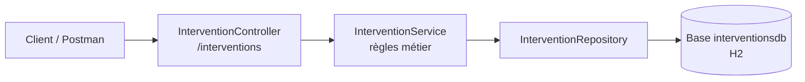

# service-interventions

Microservice du projet **Tele-Care** (assistance à domicile pour personnes âgées).
Il gère la **prise en charge terrain** d'une urgence : affectation d'un assistant d'astreinte, heure d'arrivée, compte-rendu et clôture.

| | |
|---|---|
| **Port** | 8083 |
| **Base de données** | H2 en mémoire (`interventionsdb`), propre au service |
| **Jalon livré** | **v3.0** — Configuration centralisée : ce service lit sa configuration depuis le Config Server (après v1.0 : services métier, v2.0 : client Eureka) |

---

## 1. Prérequis

| Outil | Version |
|---|---|
| Java (JDK) | 17 |
| Maven | Non requis, le wrapper `mvnw` est fourni |
| Spring Boot | 3.5.6 |
| Spring Cloud (BOM) | 2025.0.0 (clients Eureka et Config) |
| Postman | Pour rejouer la collection de tests |
| Serveur Eureka | Port 8761. Sans lui, le service démarre quand même (avertissements de connexion dans la console) |
| Config Server | Port 8888. **Sans lui, le service refuse de démarrer** (comportement voulu, voir 5.2) |

## 2. Architecture du service



Architecture en couches **Controller → Service → Repository → Entité**, avec des **DTO** validés (`@Valid`) et un mapping par **MapStruct**.
Le service a sa **propre base de données** (*Database per Service*) : il ne partage aucune table avec les autres services.

```
src/main/java/com/telecare/serviceinterventions
├── controller   InterventionController
├── service      InterventionService
├── repository   InterventionRepository
├── entite       Intervention, StatutIntervention
├── dto          InterventionCreationDto, ArriveeDto, CompteRenduDto, InterventionDto
├── mapper       InterventionMapper
└── exception    RessourceIntrouvableException, TransitionInterditeException, InterventionExistanteException
```

## 3. Modèle de données

Entité **`Intervention`**, conforme au diagramme de classes du projet :

| Attribut | Type | Description |
|---|---|---|
| `id` | `Long` | Identifiant généré |
| `alertId` | `Long` | **Référence distante** vers l'alerte (service-alertes). Aucune clé étrangère, car la base est séparée. Unique : une seule intervention par alerte |
| `assistantNom` | `String` | Assistant d'astreinte affecté (obligatoire) |
| `heureArrivee` | `LocalDateTime` | Heure d'arrivée sur place |
| `compteRendu` | `String` | Compte-rendu de l'intervention (2000 caractères max) |
| `statut` | `StatutIntervention` | Stocké en texte en base |

### Cycle de vie du statut

Le cahier des charges ne fixe pas les valeurs de `statut`. Choix de conception :

```
AFFECTEE  ──(arrivée enregistrée)──▶  SUR_PLACE  ──(compte-rendu + clôture)──▶  CLOTUREE
```

| Action | Condition | Sinon |
|---|---|---|
| Créer | Aucune intervention pour cet `alertId` | `409` |
| Enregistrer l'arrivée | Statut `AFFECTEE` | `409` |
| Rédiger le compte-rendu | Statut `SUR_PLACE` | `409` |
| Clôturer | Statut `SUR_PLACE` et compte-rendu rédigé | `409` |
| Modifier l'assistant | Statut différent de `CLOTUREE` | `409` |
| Supprimer | Statut différent de `CLOTUREE` | `409` |

## 4. API REST

| Méthode | URL | Rôle | Succès |
|---|---|---|---|
| `GET` | `/interventions` | Lister (filtre optionnel `?statut=SUR_PLACE`) | `200` |
| `GET` | `/interventions/{id}` | Consulter une intervention | `200` |
| `POST` | `/interventions/new` | Créer une intervention | `201` + `Location` |
| `PUT` | `/interventions/{id}` | Modifier l'assistant affecté (interdit si `CLOTUREE`) | `200` |
| `PUT` | `/interventions/{id}/arrivee` | Enregistrer l'heure d'arrivée (corps facultatif, heure actuelle par défaut) | `200` |
| `PUT` | `/interventions/{id}/compte-rendu` | Rédiger le compte-rendu | `200` |
| `PUT` | `/interventions/{id}/cloture` | Clôturer l'intervention | `200` |
| `DELETE` | `/interventions/{id}` | Supprimer une intervention | `204` |

**Codes d'erreur** : `400` données invalides (validation) · `404` ressource inexistante · `409` transition de statut interdite ou doublon d'`alertId`.

Exemple de création :

```json
POST /interventions/new
{
  "alertId": 42,
  "assistantNom": "Karim Benali"
}
```

## 5. Lancer le service

**Ordre de démarrage** : Eureka (8761), puis Config Server (8888), puis ce service (8083).

Depuis le dossier `service-interventions` :

```powershell
.\mvnw.cmd spring-boot:run
```

Vérification : <http://localhost:8083/actuator/health> doit renvoyer `{"status":"UP"}`.

### 5.1 Enregistrement dans Eureka (jalon v2.0)

Le service est un **client Eureka** : au démarrage, il s'enregistre auprès du serveur Eureka (port 8761) pour pouvoir être découvert par la Gateway.

| Élément | Valeur |
|---|---|
| Nom dans Eureka | `SERVICE-INTERVENTIONS` (valeur de `spring.application.name`) |
| Port | 8083 |
| Identifiant d'instance | `localhost:service-interventions:8083` |
| Statut attendu | `UP` |

Configuration (située dans `config-repo/service-interventions.properties` depuis le jalon v3.0) :

```properties
eureka.client.service-url.defaultZone=http://localhost:8761/eureka/
eureka.instance.hostname=localhost
eureka.instance.instance-id=${eureka.instance.hostname}:${spring.application.name}:${server.port}
```

La dépendance `spring-cloud-starter-netflix-eureka-client` est ajoutée au `pom.xml`, et la classe principale porte `@EnableDiscoveryClient`.

**Vérification** : démarrer le serveur Eureka, puis le service, et ouvrir <http://localhost:8761>. L'application `SERVICE-INTERVENTIONS` doit apparaître avec le statut `UP`.


### 5.2 Configuration centralisée (jalon v3.0)

La configuration du service n'est plus dans le projet : elle est dans le dossier **`config-repo`**, à la racine du dépôt Git, et servie par le Config Server.

| Élément | Emplacement |
|---|---|
| Configuration du service (port, base H2, JPA, erreurs, Eureka) | `config-repo/service-interventions.properties` |
| Configuration locale | `service-interventions/src/main/resources/application.properties` : **deux lignes seulement** |

Contenu de la configuration locale :

```properties
spring.application.name=service-interventions
spring.config.import=configserver:http://localhost:8888
```

- `spring.application.name` identifie le fichier à charger côté serveur (`service-interventions.properties`).
- `spring.config.import` charge la configuration distante au démarrage.
- Sans `optional:`, le service **refuse de démarrer** si le Config Server est injoignable (comportement *fail-fast* voulu par le TP).

La dépendance `spring-cloud-starter-config` est ajoutée au `pom.xml`.

**Vérification** : ouvrir <http://localhost:8888/service-interventions/default>. La réponse doit contenir `server.port` à `8083`, `spring.datasource.url` à `jdbc:h2:mem:interventionsdb` et les propriétés Eureka. Le service démarre ensuite sans configuration locale, s'enregistre dans Eureka (`UP`), et la collection Postman reste à 42 tests réussis.

## 6. Tests

La collection Postman est dans [`postman/service-interventions.postman_collection.json`](postman/service-interventions.postman_collection.json).

1. Démarrer le service (port 8083).
2. Dans Postman : **Import** puis choisir le fichier de la collection.
3. Clic droit sur la collection → **Run collection**.

**31 requêtes, 42 tests automatiques, tous réussis.**

| Dossier | Couverture |
|---|---|
| 1 — Cas valides | Cycle complet : création, consultation, arrivée, compte-rendu, clôture, filtre |
| 2 — Erreurs de validation | Corps invalide, JSON cassé, statut inconnu, `assistantNom` vide (`400`) |
| 3 — Ressources inexistantes | Identifiant inexistant sur chaque endpoint (`404`) |
| 4 — Règles métier | Doublon, clôture avant arrivée, double arrivée, modification ou suppression d'une intervention clôturée (`409`), suppression valide (`204`) |

## 7. Avancement par jalon

| Jalon | Contenu | État |
|---|---|---|
| **v1.0** | Couches Controller / Service / Repository, DTO validés, base propre, API REST, gestion des erreurs, tests Postman | **Terminé** |
| **v2.0** | Client Eureka : enregistrement du service dans Eureka (statut `UP`) | **Terminé** |
| **v3.0** | Configuration centralisée : fichier dans `config-repo`, service client du Config Server | **Terminé** |
