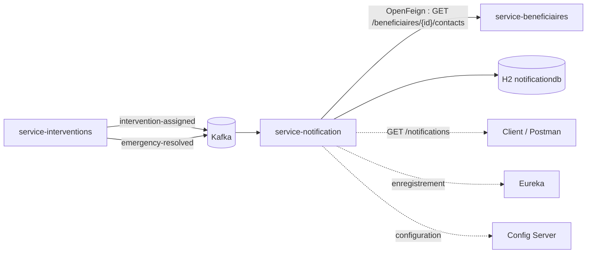

# service-notification

Microservice du projet **Tele-Care** (assistance à domicile pour personnes âgées).
Il **prévient le contact de confiance** d'un bénéficiaire quand une intervention est affectée (prise en charge) ou clôturée (résolution). C'est le seul service qui envoie les notifications : les services métier publient des événements Kafka, et ce service les consomme.

| | |
|---|---|
| **Port** | 8085 |
| **Base de données** | H2 en mémoire (`notificationdb`), propre au service |
| **Broker** | Kafka (`localhost:9092`), consommateur uniquement, groupe `service-notification` |
| **Jalon livré** | V7 : service de notification reprenant celui de V5, avec Kafka à la place de RabbitMQ |

---

## 1. Prérequis

| Élément | Version / adresse |
|---|---|
| Java | 17 |
| Maven | wrapper inclus (`mvnw`) |
| Eureka Server | `http://localhost:8761` |
| Config Server | `http://localhost:8888` (fichier `config-repo/service-notification.properties`) |
| Kafka | `localhost:9092` |
| service-beneficiaires | découvert par Eureka (fournit les contacts) |
| service-interventions | publie les événements consommés (port 8083) |

## 2. Architecture



Organisation en couches : `controller` (API de consultation), `service` (logique de notification), `repository` (Spring Data JPA), `entite` (`Notification`), `messaging` (consommateurs Kafka), `feignClient` (appel à service-beneficiaires), `config` (gestion des erreurs Kafka), `exception` et `dto`.

## 3. Fonctionnement

1. Un consommateur Kafka reçoit l'événement et le lit en JSON.
2. Si l'`eventId` a déjà été traité, le message est ignoré (**idempotence**).
3. Le service appelle `service-beneficiaires` pour récupérer les contacts du bénéficiaire.
4. Il choisit le **contact de confiance**. Un contact n'a pas d'indicateur « de confiance » (attributs : `id, beneficiaryId, nom, lien, telephone`) : le service prend le **premier contact** de la liste.
5. Il envoie la notification (envoi simulé : trace dans les logs) et l'**enregistre en base**.

Messages envoyés :

| Type | Message |
|---|---|
| `PRISE_EN_CHARGE` | `L'alerte <alertId> est prise en charge : l'assistant <assistantId> est en route.` |
| `RESOLUTION` | `L'alerte <alertId> est resolue. Compte-rendu : <compteRendu>` |

## 4. Événements Kafka consommés

### `intervention-assigned` (publié par service-interventions)

```json
{
  "eventId": "6f1c2d9e-3b7a-4c55-9a1e-2f0b8c7d1e42",
  "interventionId": 1,
  "alertId": 1000,
  "beneficiaryId": 1,
  "assistantId": 1,
  "dateAffectation": "2026-11-09T10:15:32"
}
```

### `emergency-resolved` (publié par service-interventions)

```json
{
  "eventId": "a3d4e5f6-1b2c-4d3e-8f90-123456789abc",
  "interventionId": 1,
  "alertId": 1000,
  "beneficiaryId": 1,
  "compteRendu": "Personne retrouvee consciente, constantes normales.",
  "dateCloture": "2026-11-09T11:02:10"
}
```

La clé du message Kafka est l'`alertId`. `eventId` et `beneficiaryId` sont obligatoires : sans eux, l'événement est ignoré et une erreur est écrite dans les logs.

## 5. API REST

| Méthode | URL | Rôle | Réponse |
|---|---|---|---|
| `GET` | `/notifications` | Liste des notifications envoyées | `200` |
| `GET` | `/notifications?alertId=1000` | Filtre par alerte | `200` |
| `GET` | `/notifications/{id}` | Détail d'une notification | `200`, ou `404` si introuvable |

Exemple de réponse :

```json
{
  "id": 1,
  "type": "PRISE_EN_CHARGE",
  "alertId": 1000,
  "interventionId": 1,
  "beneficiaryId": 1,
  "contactNom": "Fatima Alaoui",
  "contactTelephone": "0612345678",
  "message": "L'alerte 1000 est prise en charge : l'assistant 1 est en route.",
  "dateEnvoi": "2026-11-09T10:15:33"
}
```

Une notification inexistante renvoie `404` avec le message `Notification introuvable : <id>` (géré par le `GlobalExceptionHandler`).

## 6. Modèle de données

Entité `Notification` (table `notification`) :

| Attribut | Type | Description |
|---|---|---|
| `id` | `Long` | Identifiant généré |
| `eventId` | `String` | Identifiant de l'événement, **unique** (idempotence) |
| `type` | `TypeNotification` | `PRISE_EN_CHARGE` ou `RESOLUTION` |
| `alertId` | `Long` | Référence distante vers l'alerte (pas de clé étrangère) |
| `interventionId` | `Long` | Référence distante vers l'intervention |
| `beneficiaryId` | `Long` | Référence distante vers le bénéficiaire |
| `contactNom`, `contactTelephone` | `String` | Contact notifié |
| `message` | `String` | Texte envoyé (2000 caractères max) |
| `dateEnvoi` | `LocalDateTime` | Date de l'envoi |

## 7. Communication synchrone (OpenFeign)

Client `ContactRequest` vers `service-beneficiaires` (nom découvert par Eureka, aucune adresse en dur) :

| Appel | Réponse |
|---|---|
| `GET /beneficiaires/{beneficiaryId}/contacts` | liste de `ContactDto` (`id, beneficiaryId, nom, lien, telephone`) |

## 8. Résilience et gestion des erreurs

L'appel à service-beneficiaires est protégé par Resilience4j (instance `beneficiaires-service`) :

| Mécanisme | Réglage |
|---|---|
| Délais Feign | connexion 1 s, lecture 2 s |
| Retry | 3 tentatives, 500 ms d'attente, sur erreur de communication ou `503` |
| Circuit Breaker | fenêtre de 6 appels, au moins 4 appels, seuil d'échec 50 %, ouvert 5 s, 3 appels en test (semi-ouvert) ; les erreurs `4xx` ne l'ouvrent pas |
| Bulkhead | 10 appels simultanés maximum |

Il n'y a pas de valeur de repli : sans contact, on ne peut pas notifier. L'exception remonte au consommateur Kafka.

Gestion des erreurs côté Kafka (`KafkaConfig`) :

| Situation | Comportement |
|---|---|
| Échec du traitement (service-beneficiaires indisponible…) | 3 tentatives au total, 2 s d'intervalle, puis le message est abandonné avec une erreur dans les logs |
| Bénéficiaire introuvable (`404`) | pas de nouvel essai |
| Message JSON illisible | ignoré avec une erreur dans les logs |
| `eventId` ou `beneficiaryId` absent | ignoré avec une erreur dans les logs |
| Aucun contact pour le bénéficiaire | aucune notification, avertissement dans les logs |

**Idempotence** : un même `eventId` ne produit qu'une seule notification (vérification avant l'envoi, plus contrainte d'unicité en base pour les traitements parallèles).

## 9. Configuration

`src/main/resources/application.properties` contient seulement le nom du service et l'adresse du Config Server :

```properties
spring.application.name=service-notification
spring.config.import=configserver:http://localhost:8888
```

Le reste est externalisé dans `config-repo/service-notification.properties` : port 8085, base H2, Eureka, Kafka (consommateur), délais Feign et réglages Resilience4j.

## 10. Lancement

Ordre de démarrage : Eureka (8761), Config Server (8888), Kafka (9092), service-beneficiaires, puis ce service.

```
.\mvnw.cmd spring-boot:run
```

Vérifications : le service apparaît **UP** dans Eureka, et `http://localhost:8085/notifications` répond `[]`.

## 11. Tests manuels

1. Lancer la console Kafka pour publier un événement :

   ```
   kafka-console-producer.bat --bootstrap-server localhost:9092 --topic intervention-assigned
   ```

   Coller sur une seule ligne :

   ```
   {"eventId":"evt-001","interventionId":1,"alertId":1000,"beneficiaryId":1,"assistantId":1,"dateAffectation":"2026-11-09T10:15:32"}
   ```

2. Vérifier `GET http://localhost:8085/notifications` : une notification `PRISE_EN_CHARGE` apparaît, et les logs contiennent `NOTIFICATION PRISE_EN_CHARGE envoyee a ...`.
3. **Idempotence** : republier le même message (même `eventId`). La liste ne change pas.
4. Publier un événement sur `emergency-resolved` (avec `compteRendu` et `dateCloture`) : une notification `RESOLUTION` apparaît.
5. **Bénéficiaire introuvable** : publier un événement avec un `beneficiaryId` inexistant. Aucun nouvel essai, aucune notification.
6. **Panne** : arrêter service-beneficiaires et publier un événement. Trois tentatives sont visibles dans les logs, puis le message est abandonné.
7. `GET /notifications/999999` répond `404`.

Test de bout en bout : créer une intervention avec `POST /interventions/new` sur service-interventions (port 8083), puis vérifier `GET /notifications?alertId=<alertId>`. À la clôture de l'intervention, une notification `RESOLUTION` s'ajoute.

## 12. Avancement par jalon

| Jalon | Contenu | État |
|---|---|---|
| V1 | Base H2 propre au service, entité `Notification`, couches Entity / Repository / Service / Controller | Terminé |
| V2 | Enregistrement dans Eureka | Terminé |
| V3 | Configuration externalisée (Config Server) | Terminé |
| V4 | Client OpenFeign vers service-beneficiaires | Terminé |
| V5 / V7 | Consommateurs Kafka `intervention-assigned` et `emergency-resolved`, idempotence | Terminé |
| V6 | Retry, Circuit Breaker, Bulkhead, gestion centralisée des erreurs | Terminé |
